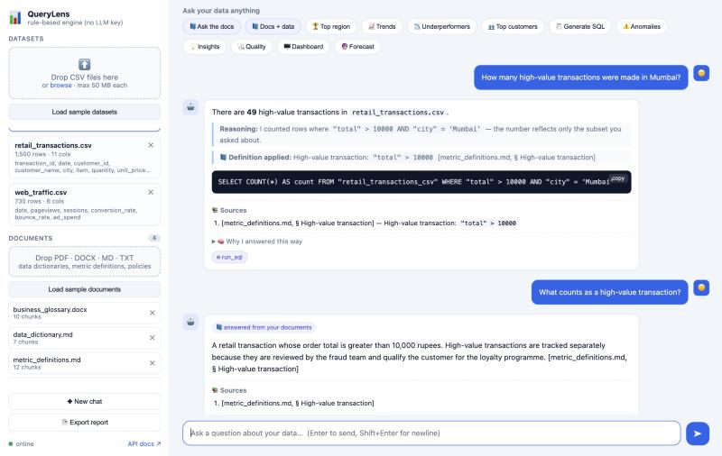
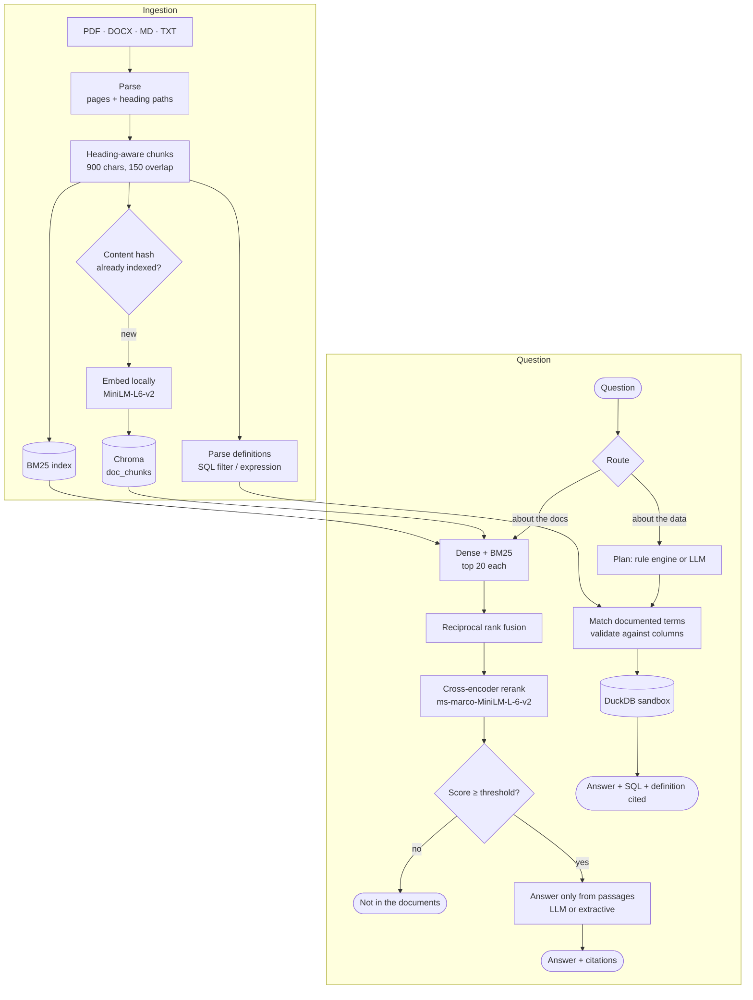

<div align="center">

# QueryLens

**Ask your data, and its documentation, in plain English.**
Hybrid-retrieval RAG over your business documents, grounded text-to-SQL over your CSVs, every answer cited.

[](https://github.com/arshkalra17/QueryLens--AI-Data-Analyst/actions/workflows/ci.yml)


[](LICENSE)

[Quickstart](#quickstart) · [How the RAG works](#how-the-rag-pipeline-works) · [Evaluation](#evaluation) · [▶ Demo video](https://github.com/user-attachments/assets/100103b5-f630-428d-8439-c9050cd89354)



</div>

---

Business data is meaningless without its definitions. *"How many **high-value transactions**
were made in Mumbai?"* can only be answered correctly by someone who has read the metric
definitions. QueryLens reads them for you:

1. **Upload your CSVs and the documents that explain them** (data dictionaries, metric
   definitions, glossaries, policies) as PDF, DOCX, Markdown or text.
2. **Ask about the documentation** (*"What counts as a high-value transaction?"*) and get an
   answer built only from retrieved passages, with citations like
   `[metric_definitions.md, § High-value transaction]` or `[reporting_policy.pdf, p.2]`. If the
   documents don't cover the question, it says so instead of guessing.
3. **Ask about the data** and the documented definition is retrieved, validated and applied
   as SQL (`WHERE "total" > 10000 AND "city" = 'Mumbai'`), executed in a sandboxed DuckDB, and
   cited in the answer.

The LLM plans and explains, but **never computes a number**: every figure comes from executed
SQL. Without an API key, a deterministic engine and an extractive answerer take over, so the
whole app, including RAG, runs offline.

## Results at a glance

Measured offline (no API key) and run in CI. Full methodology in [`benchmarks/`](benchmarks/README.md).

| | |
|---|---|
| **Document retrieval** (hybrid + rerank, 40 labelled questions) | **Recall@5 100%**, MRR 0.949 |
| **Abstention** on questions the documents don't cover | **100%** rejected, with 0 answerable questions lost ¹ |
| **SQL accuracy on definition-dependent questions** | **0/14 → 14/14** with documents (ablation) |
| **Text-to-SQL execution accuracy** (94 questions) | **98.9%** (blind held-out: 80%) |
| **Tests** | 273 offline + 4 live-LLM smoke tests, CI on Python 3.12 & 3.14 |

<sub>¹ Relevance threshold calibrated on this question set; see the caveat in the benchmark docs.</sub>

## How the RAG pipeline works



**Ingestion.** Parsers keep page numbers (PDF) and heading paths (Markdown/DOCX) so every chunk
is citable. Chunks never cross a section boundary. Chunk IDs are content hashes, so re-uploading
an edited 50-page document re-embeds only the paragraphs that changed.

**Retrieval.** Dense embeddings catch paraphrases (*"who keeps the original pricing plan?"* →
*Early subscriber*); BM25 catches exact terms and column names that small embedding models blur.
Reciprocal rank fusion combines the two without score calibration, and a cross-encoder rescores
the fused candidates by reading question and passage together. Its score is also the
**abstention gate**: below the threshold, QueryLens answers "not in the documents" instead of
improvising.

**Generation.** The LLM sees only numbered, fenced passages, must cite them, and any citation to
a passage it wasn't given is stripped. Without an LLM, the same cross-encoder picks the sentences
that answer the question and quotes them with citations.

**Grounding SQL in documentation.** Definitions with an implementation line
(`SQL filter: "total" > 10000`, `SQL expression: SUM("revenue") - SUM("cost")`) apply only to the
dataset they name, are checked against its real columns, and are rejected if they contain anything
but a plain expression. When a question uses the term, the filter is combined with the question's
other conditions, or the expression becomes the computed metric (*"gross margin by region"*,
*"lowest margin rate"*), and the answer cites the source. For the LLM path, the definitions and top
passages go into the prompt, and an audit step injects a documented filter the model forgot.

## Quickstart

### Docker (recommended)

```bash
git clone https://github.com/arshkalra17/QueryLens--AI-Data-Analyst.git
cd QueryLens--AI-Data-Analyst
cp .env.example .env          # optional: add GROQ_API_KEY for LLM answers
docker compose up --build
```

Open **http://localhost:8000**, then click **Load sample datasets** and **Load sample documents**,
and try the 📘 example questions. Streamlit runs at :8501, API docs at :8000/docs.

### Local

```bash
python -m venv .venv && source .venv/bin/activate
pip install -r requirements.txt
cp .env.example .env
cd backend && uvicorn app.main:app --reload --port 8000
```

Everything in `.env` is optional. The embedding model (~80 MB) and the reranker (~90 MB) download
on first use and run locally on CPU. A free [Groq API key](https://console.groq.com) enables the LLM path.

## Evaluation

```bash
LLM_PROVIDER=none python scripts/benchmark_rag.py -v        # document RAG
LLM_PROVIDER=none python scripts/benchmark_sql.py -v        # text-to-SQL
LLM_PROVIDER=none python scripts/benchmark_sql.py --no-docs # ablation: without documents
```

### Document RAG: retrieval ablation

40 questions over four sample documents (one per format): 34 answerable, mostly paraphrased
so they don't reuse the heading's words, and 6 the documents can't answer.

| Retrieval | Recall@1 | Recall@5 | MRR | Out-of-scope rejected | Answer correct ² | Latency |
|---|---:|---:|---:|---:|---:|---:|
| Dense (MiniLM) | 85% | 97% | 0.902 | 83% | 82% | 1 ms |
| BM25 | 79% | 100% | 0.892 | 0% | 78% | <1 ms |
| Hybrid (RRF) | 91% | 100% | 0.946 | 17% | 80% | 1 ms |
| **Hybrid + rerank** | **91%** | **100%** | **0.949** | **100%** | **88%** | 165 ms |

<sub>² Offline extractive answers. Citation accuracy 91%; faithfulness is 100% by construction for extractive answers and becomes meaningful with an LLM.</sub>

Fusion beats either retriever alone. The reranker is what makes "I don't know" possible: BM25
always finds *some* keyword overlap, so on its own it never abstains.

### Does documentation improve SQL?

| | Without documents | With documents |
|---|---:|---:|
| Questions that use a documented term (*high-value transaction*, *gross margin*, *cost per session*…) | **0/14** | **14/14** |
| All 94 SQL questions | 84.0% | **98.9%** |

### Text-to-SQL

94 questions with hand-written gold SQL; the app's SQL and the gold SQL are both **executed**
and their results compared. The offline engine went from **45.0% to 98.8%** on the 80
data-only questions. Because it was tuned on them, the honest generalisation number is the
**blind held-out split: 80%**, scored once before any fixes.

### Live LLM evaluation

Both benchmarks also run against the LLM in `.env` and record provider, model, token usage,
latency and rate-limit retries (`benchmarks/results/<provider>_<model>.json`). A weekly
[`llm-eval`](.github/workflows/llm-eval.yml) workflow runs them with the `GROQ_API_KEY` secret,
along with a `pytest -m live_llm` smoke suite.

## Engineering decisions

| Decision | Why |
|---|---|
| **Hybrid retrieval + cross-encoder rerank** | Each retriever covers the other's blind spot. The reranker fixes ordering and provides a calibrated relevance score for abstention. |
| **Abstain below a relevance threshold** | A confident wrong answer is worse than "not in the documents" for business definitions. |
| **Content-hash chunk IDs** | Re-uploading an edited document only embeds what changed, and the index never holds stale chunks. |
| **Documentation → validated SQL, not free text** | A definition only becomes SQL if it names the dataset, references real columns and is a plain expression, so a stale or hostile document can't inject queries. |
| **Untrusted content is fenced** | File-derived text (schemas, sample values, passages, past answers) sits between `<<< >>>` in prompts with an instruction never to follow it. |
| **The LLM never computes numbers** | Every figure comes from DuckDB; the model plans and narrates. Provable intents (counts, filters, rankings) skip the model entirely. |
| **DuckDB sandbox enforced by the engine** | No file or network access, a locked configuration and a 10s timeout. A keyword blocklist can't stop `read_text('/app/.env')`. |
| **Robust to weak model output** | JSON mode, bracket-repair for mis-nested JSON, and any unusable plan degrades to the rule engine instead of a 500 (found by live testing). |
| **Failures are visible, not silent** | A retired or misspelled model (HTTP 404) shows as `model_not_found` in `/api/health` and as a chat note naming the model, instead of quietly degrading to the rule engine. |
| **Offline-first** | Local embeddings, local reranker, extractive answers: the whole pipeline is testable in CI with no API key. |

## Tech stack

| Layer | Choice |
|---|---|
| RAG | ChromaDB (dense), rank-bm25 (sparse), RRF fusion, sentence-transformers cross-encoder reranker |
| Embeddings | `all-MiniLM-L6-v2` (local, CPU) |
| Documents | pypdf, python-docx, Markdown/TXT heading parsers |
| LLM | OpenAI-compatible client: Groq `gpt-oss-120b` (default), Gemini 3.5 Flash-Lite failover, JSON mode, usage tracking |
| Query engine | DuckDB (in-memory, sandboxed) over pandas DataFrames |
| API & UI | FastAPI (REST + SSE streaming), vanilla JS web app, Streamlit |
| Analytics | scikit-learn IsolationForest, SciPy, Plotly, matplotlib |
| Storage | SQLite sessions, Chroma persistent stores, diskcache embedding cache |
| Ops | Docker (non-root, health-checked), GitHub Actions: tests + both benchmarks per push, weekly live-LLM eval |

## API

| Endpoint | Description |
|---|---|
| `POST /api/documents` | Upload PDF/DOCX/MD/TXT. Returns chunks embedded vs reused. |
| `POST /api/documents/search` | Hybrid search in any mode (`dense`, `bm25`, `hybrid`, `hybrid_rerank`) with each retriever's rank, the rerank score and an optional cited answer. |
| `GET /api/documents` · `DELETE /api/documents/{id}` | List documents and parsed definitions; delete. |
| `POST /api/datasets` | Upload CSVs (validated and profiled). |
| `POST /api/chat` · `POST /api/chat/stream` | Ask anything. The response includes `route` (`data`/`documents`), `sql` and `citations`. Streaming uses SSE. |
| `GET /api/chat/session/{id}/history` | Conversation history (persists across restarts). |
| `GET /api/health` · `GET /api/metrics` | Health, LLM usage, timings and counters. |

## Configuration

| Variable | Default | Purpose |
|---|---|---|
| `GROQ_API_KEY` | – | Enables the LLM path. |
| `GROQ_MODEL` | `openai/gpt-oss-120b` | Groq model; `openai/gpt-oss-20b` is the smaller, faster option. |
| `GEMINI_MODEL` | `gemini-3.5-flash-lite` | Failover model when Groq is unavailable or rate-limited. |
| `ENABLE_DOCS` | `true` | Document RAG. |
| `DOC_RETRIEVAL_MODE` | `hybrid_rerank` | `dense`, `bm25`, `hybrid` or `hybrid_rerank`. |
| `DOC_MIN_RERANK_SCORE` | `-6.0` | Abstention threshold. |
| `DOC_TOP_K` | `5` | Passages per question. |
| `SQL_TIMEOUT_SECONDS` | `10` | Per-query time limit. |
| `SQL_REPAIR_ATTEMPTS` | `2` | LLM retries for failed SQL. |
| `DETERMINISTIC_INTENTS` | `true` | `false` sends every question to the LLM planner. |

The full list is in [`.env.example`](.env.example).

## Project structure

```
backend/app/
├── knowledge/          document RAG: parsing · chunking · store (Chroma + BM25) · retrieval
│                       (RRF + rerank) · answer (cited) · definitions (docs → validated SQL)
├── engine/             agent (routing, planning, SQL repair) · rule engine · conditions ·
│                       sandboxed SQL · tools · charts · anomalies · forecast
├── rag/                conversation memory: past Q&A retrieval per session
├── core/               LLM client (failover, JSON mode, usage) · sessions (SQLite) · registry
└── api/routes/         documents · datasets · chat (REST + SSE) · charts · reports · metrics
benchmarks/             RAG + SQL cases, results, methodology
scripts/                benchmark_rag.py · benchmark_sql.py · generate_sample_docs.py
sample_data/            4 CSV datasets + 4 business documents (MD, DOCX, PDF)
frontend/               web app served at :8000
```

## Limitations and roadmap

- **Small evaluation sets.** Four documents and 134 questions are regression suites, not research
  benchmarks; the abstention threshold is calibrated in-sample.
- **Live-LLM numbers.** The tooling is in place; results for Groq models will be added from
  the `llm-eval` workflow.
- **Executable definitions need a `SQL filter` / `SQL expression` line.** Prose-only definitions
  are retrieved and cited, and passed to the LLM, but not executed by the offline engine.
- **Single-table SQL** is what's benchmarked; cross-file joins aren't covered yet.
- **Next:** OCR for scanned PDFs, request tracing (OpenTelemetry/Langfuse), and retrieving
  verified question → SQL pairs as few-shot examples.

<details>
<summary>More screenshots</summary>
<br>
<br><br>
<br><br>
<br><br>

</details>

## License

[MIT](LICENSE) © 2026 Arsh Kalra
