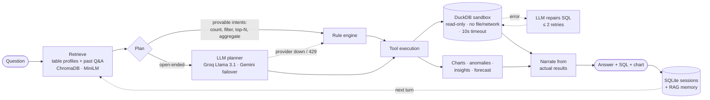

<div align="center">

# QueryLens

**Ask questions about your CSVs in plain English. Get answers computed by real SQL, not guessed by an LLM.**

[](https://github.com/arshkalra17/QueryLens--AI-Data-Analyst/actions/workflows/ci.yml)


[](LICENSE)

[**▶ Watch the demo**](https://github.com/user-attachments/assets/100103b5-f630-428d-8439-c9050cd89354) · [Quickstart](#quickstart) · [How it works](#how-it-works) · [Evaluation](#evaluation)


</div>

---

QueryLens is a text-to-SQL analytics agent. Upload one or more CSVs, ask *"which region
generated the highest revenue?"*, and it retrieves the relevant schema context, plans tool
calls, runs read-only SQL in a sandboxed DuckDB, and explains the result, with the SQL and a
chart alongside the answer.

The core design rule: **the LLM plans and explains; it never computes a number.** Every figure
in an answer comes from executed SQL, statistical code, or chart data. When no LLM is
configured or the provider is rate-limited, a deterministic rule engine answers instead, so
the app never stops working.

## Results at a glance

| | |
|---|---|
| **Text-to-SQL execution accuracy** (offline engine, 80 questions) | **98.8%**, up from 45.0% ([method](benchmarks/README.md)) |
| **Blind held-out accuracy** (20 unseen questions, scored once) | **80%** |
| **Automated tests** | 222, offline, run in CI on Python 3.12 and 3.14 |
| **Median answer latency** (offline engine) | ~150 ms |
| **Runs without any API key** | Yes: rule engine fallback, local embeddings, local vector store |

## Features

- **Natural-language analytics.** Counts, filters, aggregates, group-bys, top/bottom-N,
  date ranges, duplicates, percentages and follow-ups ("now show that as a percentage of total").
- **Schema-grounded retrieval.** Compact table profiles and past Q&A are embedded locally
  (`all-MiniLM-L6-v2`) and retrieved from ChromaDB per question. Raw rows are never put in the prompt.
- **14 server-side tools.** SQL, filtering, duplicates, charts (Plotly + matplotlib), anomaly
  detection (IsolationForest, z-score, IQR), insights, data-quality scoring, trend/seasonality forecasting.
- **Self-correcting SQL.** If LLM-generated SQL fails, the DuckDB error goes back to the model
  for up to two repair attempts.
- **Multi-file sessions** that persist in SQLite: conversations survive restarts and are shared
  across API workers.
- **Three interfaces.** A vanilla-JS web app and REST/SSE API (FastAPI), a Streamlit app, and Swagger docs.
- **Exports.** HTML/Markdown reports, dashboards, and chart images.

## How it works



1. **Retrieve.** Each upload is profiled (columns, types, null counts, ranges, sample values) and
   the profile is embedded. Each question retrieves the most relevant profiles plus similar past
   turns, limited to the datasets attached to that session.
2. **Plan.** Questions with a provably correct answer (counts, filters, aggregates, rankings,
   schema, duplicates) go straight to the deterministic engine, so a flaky model can never corrupt
   them. Everything else is planned by the LLM as tool calls, and the rule engine is the fallback.
3. **Execute.** Tools run server-side. SQL runs in DuckDB with external access disabled; numbers,
   anomalies and trends come from real computation.
4. **Narrate.** The LLM (or the rule engine) writes the answer from the actual tool output. The SQL
   is shown so every number can be checked.

## Quickstart

### Docker (recommended)

```bash
git clone https://github.com/arshkalra17/QueryLens--AI-Data-Analyst.git
cd QueryLens--AI-Data-Analyst
cp .env.example .env          # optional: add GROQ_API_KEY for LLM answers
docker compose up --build
```

Then open **http://localhost:8000** (web app), **http://localhost:8501** (Streamlit) or
**http://localhost:8000/docs** (API). Click **Load sample datasets** to try it on the bundled data.

### Local

```bash
python -m venv .venv && source .venv/bin/activate
pip install -r requirements.txt
cp .env.example .env
cd backend && uvicorn app.main:app --reload --port 8000
# optional second UI:
streamlit run app/ui/streamlit_app.py --server.port 8501
```

Everything in `.env` is optional. With no keys the app runs fully on the rule engine. A free
[Groq API key](https://console.groq.com) enables the LLM path.

## Evaluation

QueryLens is measured by **execution accuracy**: 80 questions over the sample datasets, each
with hand-written gold SQL. The app's SQL and the gold SQL are both executed, and the *results*
are compared rather than the SQL text.

```bash
LLM_PROVIDER=none python scripts/benchmark_sql.py -v
```

| Category | Cases | Before | After |
|---|---:|---:|---:|
| Aggregates (sum / avg / max / min, with or without filters) | 24 | 7 | **24** |
| Filtered counts | 17 | 9 | **17** |
| Group-by breakdowns | 11 | 0 | **11** |
| Top-k / bottom-k rankings | 18 | 13 | **17** |
| Plain counts, distinct counts, date filters | 10 | 7 | **10** |
| **Total** | **80** | **36 (45.0%)** | **79 (98.8%)** |

The engine was tuned on these questions, so the more honest number is the **blind held-out set:
16/20 = 80%** on its first and only scoring run. The questions were written in three rounds to
make that possible. [`benchmarks/README.md`](benchmarks/README.md) covers the methodology, the
splits, what each fix was, and the limits of an 80-question suite.

The benchmark runs in CI as a regression gate (fails below 95%), alongside 222 offline tests
covering SQL sandboxing, retrieval, the SQL repair loop, session persistence, condition
grounding and the scoring logic itself. A separate scenario harness (`scripts/evaluate.py`) checks
end-to-end behaviour (charts, anomalies, insights) and can run against a real LLM.

## Engineering decisions

| Decision | Why |
|---|---|
| **DuckDB isolation enforced by the engine, not a regex** | A keyword blocklist can't stop `SELECT * FROM read_text('/app/.env')`. Every query connection disables file and network access and extension loading, then locks its configuration. Regression tests try file reads, globbing and re-enabling access. |
| **Query timeout via `interrupt()`** | A generated cross join must not pin a worker. Queries are interrupted at `SQL_TIMEOUT_SECONDS` (10s by default). |
| **Deterministic path for provable intents** | Counts and filters have exactly one right answer. Routing them away from the model makes them immune to hallucination and rate limits, and keeps the median latency around 150 ms. |
| **SQL self-repair loop** | Most text-to-SQL failures are a wrong column name or a type mismatch. Feeding the DuckDB error back to the model fixes these without user involvement, and attempts are capped and counted in metrics. |
| **Retrieve profiles, not rows** | Prompts stay small and data never leaks into them. Retrieval is limited to the session's own datasets and history. |
| **Sticky dataset selection** | With several files loaded, one shared word ("total *sales* amount") used to silently switch the query to a different file. The attached file now wins unless another is clearly more relevant. |
| **Provider failover and caching** | Groq first, Gemini on rate limits, then the rule engine. 429s are retried honouring `Retry-After` with backoff, and identical prompts hit an LRU cache. |
| **SQLite sessions with write-through** | In-process sessions vanished on restart and diverged across workers. SQLite in WAL mode fixes both with no extra infrastructure. |
| **Local embeddings and vector store** | No external vector service, and nothing leaves the machine except optional LLM calls. The embedding cache is keyed by SHA-256 of the model name and text, so it survives restarts. |

## Tech stack

| Layer | Choice |
|---|---|
| API | FastAPI, Pydantic v2, Server-Sent Events for streaming |
| Query engine | DuckDB (in-memory, sandboxed) over pandas DataFrames |
| Retrieval | sentence-transformers `all-MiniLM-L6-v2`, ChromaDB (persistent, cosine HNSW) |
| LLM | OpenAI-compatible client: Groq `llama-3.1-8b-instant` (default), Gemini failover |
| Analytics | scikit-learn IsolationForest, SciPy, pandas |
| Charts | Plotly (interactive), matplotlib (PNG for API and reports) |
| Storage | SQLite (sessions), local files (uploads), diskcache (embeddings) |
| UIs | Vanilla JS SPA served by FastAPI, Streamlit |
| Ops | Docker (non-root, health-checked Compose), GitHub Actions CI |

## Configuration

All settings are environment variables (see [`.env.example`](.env.example)). The most useful:

| Variable | Default | Purpose |
|---|---|---|
| `GROQ_API_KEY` | – | Enables the LLM path (primary provider). |
| `GEMINI_API_KEY` | – | Failover provider when Groq is rate-limited. |
| `LLM_PROVIDER` | `openai` | `none` forces the offline rule engine. |
| `LLM_MODEL` | `llama-3.1-8b-instant` | Any model your provider serves, e.g. `llama-3.3-70b-versatile`. |
| `ENABLE_RAG` | `true` | Retrieval over table profiles and past Q&A. |
| `SQL_TIMEOUT_SECONDS` | `10` | Per-query time limit. |
| `SQL_REPAIR_ATTEMPTS` | `2` | LLM retries for failed generated SQL. |
| `SESSION_STORE` | `sqlite` | `memory` keeps sessions in-process only. |
| `APP_API_KEY` | – | Requires `Authorization: Bearer <key>` on `/api` (the bundled UIs don't send it). |

## API

| Endpoint | Description |
|---|---|
| `POST /api/datasets` | Upload one or more CSVs (validated, profiled and indexed for retrieval). |
| `GET /api/datasets/{id}/preview` | First rows of a dataset. |
| `POST /api/chat` | Ask a question; returns the answer, reasoning, SQL, chart ids and the tools used. |
| `POST /api/chat/stream` | Same as above, streamed as Server-Sent Events (plan, tool progress, tokens). |
| `GET /api/chat/session/{id}/history` | Conversation history (persists across restarts). |
| `POST /api/charts` · `GET /api/charts/{id}/image` | Generate and fetch charts. |
| `POST /api/insights` | Automatic business insights for a dataset. |
| `POST /api/reports/{id}/html` | Exportable report. |
| `GET /api/health` · `GET /api/metrics` | Health check, per-stage timings (plan, answer, total) and counters such as SQL repairs. |

Full interactive docs at `/docs`.

## Project structure

```
backend/app/
├── main.py                 FastAPI app (lifespan: registry reload + RAG index)
├── config.py               Settings from environment (pydantic-settings)
├── prompts.py              Planner, narration and SQL-repair prompts
├── api/routes/             datasets · chat (REST + SSE) · charts · dashboards · reports · insights · metrics
├── core/                   registry · sessions (SQLite) · llm client (failover, backoff, cache) · security
├── rag/                    profiling · embeddings · ChromaDB store · retrieval
├── engine/
│   ├── agent.py            turn orchestration: retrieve → plan → audit → execute → repair → narrate
│   ├── fallback.py         deterministic rule engine (intent routing, SQL generation, narration)
│   ├── conditions.py       WHERE grounding: years, comparisons, named values
│   ├── sql_exec.py         DuckDB sandbox (isolation, timeout, row caps)
│   ├── tools.py            the 14 tools the planner can call
│   └── charts · anomalies · insights · quality · forecast
└── ui/streamlit_app.py
benchmarks/                 text-to-SQL cases, results and methodology
scripts/                    benchmark_sql.py · evaluate.py · sample-data generator
frontend/                   static web app served at :8000
```

## Screenshots

<details>
<summary>More screenshots</summary>
<br>
<br><br>
<br><br>
<br><br>

</details>

## Limitations and roadmap

- **Single-table questions are what's benchmarked.** Cross-file joins are supported in SQL (every
  dataset is registered as a table) but aren't covered by the benchmark yet.
- **The rule engine is pattern-based.** It is reliable on the phrasings it covers (80% on unseen
  ones) but can't map business synonyms ("sales" to a column named `total`). That gap is what
  the LLM path is for.
- **Benchmarking the LLM path** needs an API key and isn't part of CI yet; `scripts/benchmark_sql.py`
  already supports it.
- **Retrieval is lightweight.** It works over a handful of table profiles. Next steps are
  column-level chunks and retrieving verified question → SQL examples as few-shot prompts.
- **Observability.** There are metrics endpoints today, but no request tracing yet
  (OpenTelemetry / Langfuse is planned).

## License

[MIT](LICENSE) © 2026 Arsh Kalra
