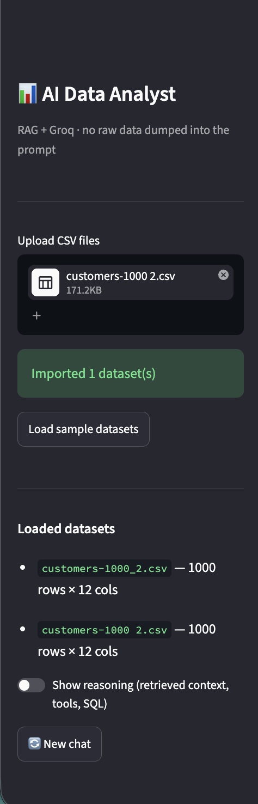
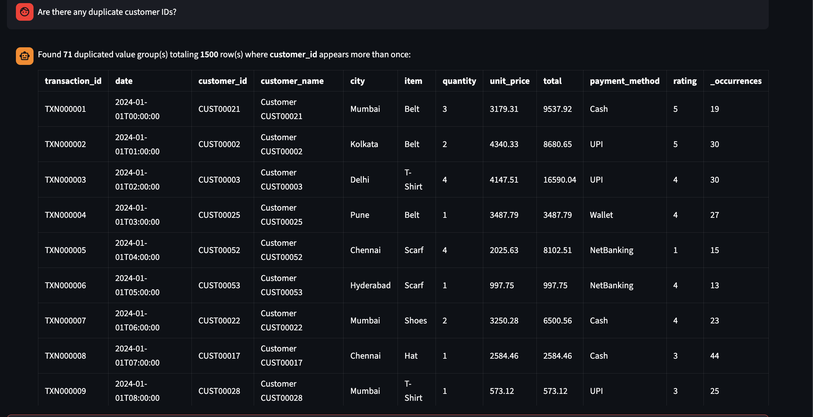
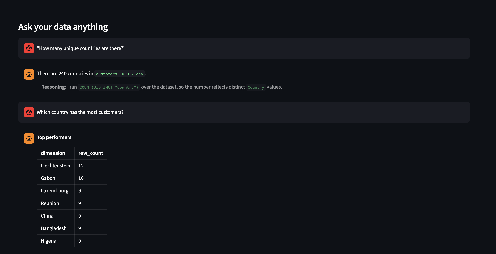
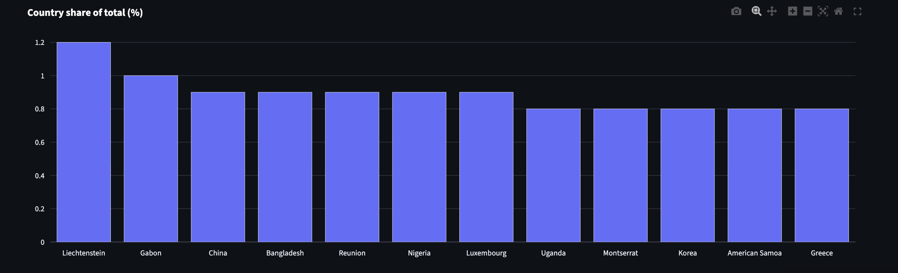
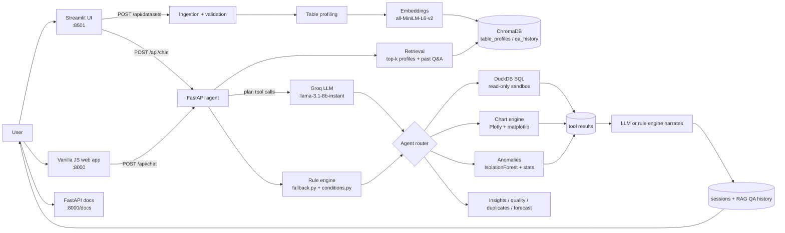

# AI Data Analyst

A production-grade **AI-powered Data Analyst** web app: upload CSVs and ask questions in natural
language. It is **RAG-based and tool-augmented** — a retrieval layer and a deterministic execution
engine surround the LLM, so the model never sees raw data dumped into its prompt and never computes
numbers itself.

- **LLM**: Groq (`llama-3.1-8b-instant` default, `llama-3.3-70b-versatile` optional) via a thin,
  swappable OpenAI-compatible client with 429 retry/backoff + an exact-match response cache.
- **RAG**: `sentence-transformers` embeddings + ChromaDB (persistent, fully local) over *table
  profiles* and past conversation turns.
- **Deterministic execution**: DuckDB SQL (read-only, validated), statistical anomaly detection,
  Plotly/matplotlib charts — none of it LLM-computed.
- **Three UIs**: a Streamlit app, a static vanilla-JS web app served by FastAPI, and the FastAPI
  docs itself.
- **No OpenAI, no external vector service.**

---

## Screenshots & Demo


<div>
  
  
  
  
  
</div>


### Demo video

<video controls width="100%">
  <source src="images/AI%20Data%20Analyst_%20SQL-Powered%20RAG%20Demo.mp4" type="video/mp4">
  Your browser does not support the video tag.
  <a href="images/AI%20Data%20Analyst_%20SQL-Powered%20RAG%20Demo.mp4">Download the demo video</a>
</video>

---

## Why this is RAG + tools, not an LLM wrapper

The LLM call sits inside a pipeline; it is one node, not the whole graph:

```
upload ──► validate ──► profile (compact stats) ──► embed ──► ChromaDB (table_profiles)
                                                                 │
user question ──────────────────────────────────────────────► retrieve (top-k profiles + past Q&A)
                                                                 │
                                                                 ▼
                                                        agent/router (classify intent)
                                                                 │
                                     ┌───────────────────────────┼───────────────────────────┐
                                     ▼                           ▼                           ▼
                          deterministic rule engine       LLM plan (tool calls)       LLM plan failed?
                          (forced intents: preview,       then tools run server-side   ──► rule engine
                           count, filter, schema,         and results are grounded         (fallback)
                           duplicates, top/bottom,        before narration
                           percentage follow-ups)
                                     │                           │
                                     └────────────┬──────────────┘
                                                  ▼
                                ┌──────────────────────────────────────────┐
                                ▼          ▼            ▼          ▼        ▼
                            run_sql   generate_chart  detect_   generate_   forecast
                           (DuckDB)   (Plotly/MPL)    anomalies  insights   (trend /
                                                      (IF + stats)           seasonality)
                                └──────────────────────────────────────────┘
                                                  │
                                                  ▼
                                       LLM narrates using ACTUAL tool output
                                       (never raw rows, never invented numbers)
                                                  │
                                                  ▼
                           answer + reasoning + SQL + charts → user
                                                  │
                                                  ▼
                              turn stored in sessions + RAG QA history (for next retrieval)
```

Key properties:

1. **The LLM never sees raw datasets.** It is grounded by retrieved, compact table profiles and
   similar past Q&A. Schema snippets (column names/types/stats/samples) are the largest context it
   gets.
2. **Numbers come from real execution.** SQL runs in a read-only DuckDB sandbox; anomalies come from
   `IsolationForest` and Z-score/IQR; trends come from the actual chart data. The LLM *narrates*
   those outputs — it does not calculate them.
3. **Deterministic intents are never left to the model.** Questions that have a provably correct
   answer ("how many…", "list rows where…", "which country has the most customers?", "are there
   duplicate ids?") bypass LLM planning and narration entirely and go through the rule engine, so a
   flaky or rate-limited model can never corrupt them.
4. **Retrieval grounds generation.** Every turn queries the vector store for the most relevant table
   profiles + past Q&A *before* SQL/chart generation, which is what makes follow-up questions
   ("now show that as a percentage of total") work.

---

## Architecture diagram



---

## Setup

### 1. Prerequisites

- Python 3.11+ (tested on 3.14)
- Optional: a Groq API key (free at <https://console.groq.com>) for the LLM path. Without any key the
  app still works fully using the built-in rule engine.

### 2. Install

```bash
cd /path/to/project
python -m venv .venv && source .venv/bin/activate
pip install -r requirements.txt
```

### 3. Configure

```bash
cp .env.example .env
```

Fill in (all optional except you want LLM-powered answers):

| Variable | Purpose |
|---|---|
| `GROQ_API_KEY` | Primary LLM provider (Groq). |
| `LLM_MODEL` | Model served by Groq, e.g. `llama-3.1-8b-instant` or `llama-3.3-70b-versatile`. Must be a model your provider serves. |
| `GEMINI_API_KEY` | Optional backup provider, auto-failover on rate limits. |
| `ENABLE_RAG` | `true` (default) to enable retrieval over table profiles + past Q&A. |
| `EMBEDDING_MODEL` | Local embedding model (`all-MiniLM-L6-v2` default; downloads ~80 MB on first RAG use). |
| `APP_API_KEY` | Optional: if set, all `/api` endpoints require `Authorization: Bearer <key>`. |
| `LLM_PROVIDER` | `openai` (default) for Groq/OpenAI-compatible endpoints, or `none` to force the rule engine. |

### 4. Run the API

```bash
cd backend
uvicorn app.main:app --reload --port 8000
```

### 5. Run a UI

```bash
# Streamlit UI (from backend/)
streamlit run app/ui/streamlit_app.py --server.port 8501

# or: the built-in web app is already served by FastAPI at http://localhost:8000
```

Open:

- Streamlit UI → <http://localhost:8501>
- Built-in web app → <http://localhost:8000>
- API docs (Swagger) → <http://localhost:8000/docs>
- Health check → <http://localhost:8000/api/health>

### Docker

```bash
GROQ_API_KEY=... GEMINI_API_KEY=... docker compose up --build
```

- API → <http://localhost:8000>, Streamlit UI → <http://localhost:8501>
- Persisted uploads, the RAG store, and the embedding cache live in `./data/` via bind mounts.

---

## Project structure

```
.
├── backend/app/
│   ├── main.py              # FastAPI entrypoint (lifespan: registry reload + RAG index)
│   ├── config.py            # Settings from .env (pydantic-settings)
│   ├── prompts.py           # LLM prompt templates (SQL gen, narration, anomaly explanation)
│   ├── api/routes/          # datasets, chat (REST + SSE), charts, dashboards, reports,
│   │                        #   insights, metrics/health
│   ├── core/                # registry (persistence), sessions/memory, llm client (backoff+cache),
│   │                        #   security (API key), logging/metrics, caching
│   ├── rag/                 # profiling, embeddings, ChromaDB store, retrieval
│   ├── engine/
│   │   ├── agent.py         # turn orchestration: plan → audit → tools → narrate → remember
│   │   ├── fallback.py      # rule engine: intent routing, sql_for_question, narratives
│   │   ├── conditions.py    # WHERE grounding ("in 2021", "where X = Y", "in Japan")
│   │   ├── sql_exec.py      # DuckDB read-only sandbox (SELECT/WITH only, timeout)
│   │   ├── tools.py         # tool registry: run_sql, filter_rows, find_duplicates, generate_chart,
│   │   │                    #   generate_sql, preview, schema, anomalies, insights, quality, forecast
│   │   ├── charts.py        # matplotlib + Plotly chart engine (count/percent aggregation)
│   │   ├── anomalies.py     # IsolationForest + z-score/IQR
│   │   ├── insights.py      # business insights + narration
│   │   ├── quality.py       # data-quality scoring
│   │   └── forecast.py      # trend + seasonality
│   └── ui/streamlit_app.py  # Streamlit client of the REST API
├── frontend/                # static vanilla-JS web app served at :8000
├── tests/                   # 175 tests (offline: LLM_PROVIDER=none)
├── sample_data/             # demo CSVs (sales, retail transactions, web traffic, customers)
├── scripts/evaluate.py      # scenario evaluation harness (vs real LLM)
├── Dockerfile
├── docker-compose.yml
├── requirements.txt
└── .env.example
```

---

## Tests & evaluation

```bash
cd backend
pytest              # full suite (offline: LLM_PROVIDER=none, RAG enabled per test)
```

The suite (175 tests) includes:

- **Eval set** (`tests/test_eval_scenarios.py`): end-to-end scenario prompts run deterministically
  against the rule engine so CI stays stable.
- **RAG tests** (`tests/test_rag.py`): profiling, embedding, ChromaDB retrieval, cross-turn memory.
- **Condition tests** (`tests/test_conditions.py`): WHERE grounding/injection.
- **LLM client tests** (`tests/test_llm_client.py`): 429 detection, retry-after parsing, backoff,
  caching.
- **Fallback / tools / charts / SQL / anomalies / registry / API / sessions** coverage, including
  duplicate detection, percentage follow-ups, and the shared SQL generator.

To evaluate against the *real* LLM (uses Groq tokens):

```bash
../.venv/bin/python scripts/evaluate.py \
  --csv sample_data/sales_data.csv sample_data/retail_transactions.csv --fail-below 0.6
```

---

## Groq model choice & rate-limit handling

- **Default** `llama-3.1-8b-instant`: high free-tier request cap, low latency.
- **Optional** `llama-3.3-70b-versatile`: higher reasoning quality, lower free-tier cap.
- The Groq free tier limits tokens/day. The app throttles itself:
  - HTTP 429 responses are **retried honouring `Retry-After`** with exponential backoff
    (`app/core/llm.py`).
  - `LLMClient` has an **exact-match LRU cache** so repeated identical questions don't burn
    requests/tokens.
  - A **backup provider** (Gemini) is tried automatically if Groq is exhausted; if all providers fail
    the app degrades to the rule engine — it never breaks.

---

## Assumptions & implementation notes

### Intent handling

- **Deterministic routing.** Intents with a provably correct answer — preview rows, counts, row
  filters ("list customers from India"), schema, duplicates, top/bottom-N, and percentage
  follow-ups — bypass LLM planning and narration (`forced_deterministic` in `agent.py`). The LLM is
  only used where it adds value (free-form analysis, narration).
- **Single shared SQL generator.** `fallback.sql_for_question(record, question)` is the *only* place
  that turns a question into SQL. Both the direct-answer path and the explicit "generate SQL for X"
  tool call it, so a fix to intent/column resolution applies everywhere. Framing words
  ("generate SQL for …") are stripped before intent detection.
- **Condition grounding.** Qualifiers ("subscribed in 2021", "where Country = Japan", "in Japan")
  are translated into a `WHERE` clause and injected into generated SQL, so "how many customers
  subscribed in 2021?" never silently counts the whole table. When a condition cannot be grounded,
  the user is shown a warning instead of an unfiltered answer.
- **Explicit conditions beat generic phrasing.** "How many customers where Country = Japan?" is a
  *count* of the filtered subset, not a list of rows.
- **Top/bottom ranking.** "Which country has the most customers?" ranks by `COUNT(*)` per group and
  groups by a real dimension (`Country`), never by an identifier column (`Customer Id`) or a row
  index. Ties at the display limit are surfaced.
- **Duplicate detection.** `find_duplicates` uses exact matching equivalent to
  `GROUP BY <cols> HAVING COUNT(*) > 1`. A dataset of all-unique identifiers answers "no duplicates"
  rather than echoing every row.
- **Percentage follow-ups.** "Now show that as a percentage of total" resolves the anaphora
  ("that") against the immediately preceding turn, reuses its grouping dimension, and expresses each
  group as `COUNT(*) / SUM(COUNT(*)) OVER ()` percent. Without a prior turn, an explicit "of total"
  percentage request still produces a grouped breakdown.

### Charts

- **Never plot row indices.** Columns that are auto-generated indices (`Index`, `Row No`, `ID`, …)
  are excluded from automatic x/y selection.
- **Count/percent aggregation.** `agg="count"` plots rows-per-category; `agg="percent"` plots each
  category as a share of total — both computed from the real data, not a made-up metric.
- Captions (highest/lowest) are computed over the *full* result before top-N truncation, so claims
  stay globally true.

### Conversation memory

- **Sessions** store per-session message history (`conversation_window=8` recent messages fed to the
  LLM). The rule engine reads the same history to resolve follow-ups.
- **RAG** stores question + SQL + summary per turn, so similar future questions retrieve prior
  answers and their context.

### Data & execution safety

- Multiple CSVs may be attached to a session; column/name matching steers tools to the dataset that
  actually contains the named columns.
- SQL is restricted to `SELECT`/`WITH` (read-only); a 10s timeout caps runaway queries.
- Uploads persist to `data/uploads` under a filesystem-safe name that keeps the original extension,
  so table names stay stable across restarts (no double-suffix mangling).
- Charts are rendered with both matplotlib PNG (API/SSE + reports) and an interactive Plotly spec
  (Streamlit UI).
- Embeddings/ChromaDB are fully local; no external vector service.

---

## Known limitations

- Groq free-tier token cap can throttle heavy demoing; failover + the rule engine cover this, but a
  paid tier removes the friction.
- The rule engine answers deterministically but is less nuanced than the LLM path.
- `all-MiniLM-L6-v2` is a compact English-centric model; multilingual or domain-specific text
  benefits from a larger model (`EMBEDDING_MODEL`).
- First RAG use downloads the embedding model (needs network).
